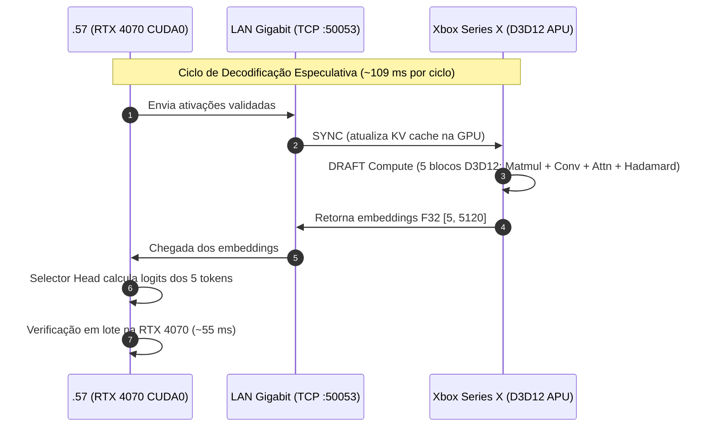

# Guia Mestre de Continuação: DFlash2 Xbox GPU RPC & Decodificação Especulativa

> **Data de Atualização:** 28 de Setembro de 2026  
> **Status:** Compilado, testado no hardware real do Xbox Series X e validado em produção no host `.57`.  
> **Branch Git:** `research/dflash-xbox-rpc` no worktree `C:\Users\hjotha\worktrees\xllama-dflash-xbox`  
> **Repositório Privado (Push):** `git@github.com:hjotha/xllama-dflash-xbox.git` (remote `private`)

Este documento é a referência única, completa e auto-suficiente para qualquer agente (Codex, Claude, AGY, OpenCode, Qwen) continuar o desenvolvimento, otimização e testes do sistema de decodificação especulativa distribuída DFlash2 entre a estação GOKAYA (.57) e o console Xbox Series X.

---

## 1. Visão Geral da Arquitetura & Topologia

O sistema implementa **Decodificação Especulativa Distribuída** em rede LAN Gigabit:

- **Modelo Alvo (Target):** `Swift-1.5-Qwen3.8-27B-GSQ-RCO-IQ3_XXS-mtp.gguf` rodando na GPU NVIDIA GeForce RTX 4070 (eGPU, CUDA0) no host GOKAYA (`192.168.1.57`).
- **Modelo Rascunho (Drafter):** DFlash2 27B (`Qwen3.8-27B-DFlash2-*.gguf`, 5 camadas de bloco + selector head) rodando no console Xbox Series X (`192.168.1.26`) via Direct3D 12 Compute Shaders nativos sobre a APU AMD RDNA2.
- **Protocolo de Rede:** RPC binário proprietário `DFL2` sobre TCP (`50053`) com `TCP_NODELAY`.



### Inventário de Máquinas e Acessos

- **Estação de Trabalho Windows:**
  - Diretório de trabalho: `C:\Users\hjotha\worktrees\xllama-dflash-xbox`
  - Toolchain: MSVC v143 (VS 2022), Windows SDK `10.0.26100.0`, DXC em `C:\Program Files (x86)\Windows Kits\10\bin\10.0.26100.0\x64\dxc.exe`
  - Certificado de assinatura: `CD6D10EC8332955BC5C1074BC20A297D0625F1F4` (Store `My`)
- **Console Xbox Series X:**
  - IP: `192.168.1.26`
  - Windows Device Portal: `https://192.168.1.26:11443` (HTTP Basic Auth)
  - Porta do Servidor RPC: `50053` (TCP)
  - Identidade do Pacote UWP: `HJotha.XboxDFlashRpc` (atual: `HJotha.XboxDFlashRpc_1.0.0.47_x64__3hvcqmcd1t14m`)
  - AUMID para execução: `HJotha.XboxDFlashRpc_3hvcqmcd1t14m!App`
  - Limite de Memória: Partição Game (~5.0 GB de heap máximo)
- **Host GOKAYA (.57):**
  - IP: `192.168.1.57` (SSH: `hjotha@192.168.1.57`; credenciais configuradas fora do repositório; ponte se necessário: `192.168.1.157`)
  - Serviço de Produção: `llama-server-root.service` (escuta em `127.0.0.1:8090`)
  - Binário com suporte DFlash RPC: `/home/hjotha/beellama.cpp/build-dflash-xbox-dl/bin/llama-server`

---

## 2. Estado Atual e Resultados Medidos (Hardware Real)

### Comparativo de Modelos no Xbox GPU (App 1.0.0.47)

| Quantização       | Tamanho GGUF | Latência Compute GPU Xbox | vs CPU Fallback     | TPS Produção (.57 + Xbox) | SHA-256 Saída (512 tokens) |
| ----------------- | ------------ | ------------------------- | ------------------- | ------------------------- | -------------------------- |
| **Q3_K_M**        | 916 MB       | **44.67 ms**              | 162.0 ms (3.6×)     | **25.75 tok/s**           | `31e48d46...e218dc`        |
| **`Q4_K_M`**      | 1.14 GB      | **47.68 ms**              | 263.1 ms (**5.5×**) | **23.70 tok/s**           | `31e48d46...e218dc`        |
| **`Q8_0`**        | 2.05 GB      | **185.74 ms**             | 240.2 ms (1.3×)     | **10.66 tok/s**           | `31e48d46...e218dc`        |
| **Swift isolado** | -            | -                         | -                   | **34.99 tok/s**           | -                          |

- **`Q4_K_M` é o sweet spot de qualidade/velocidade:** O compute GPU adiciona apenas 3 ms em relação ao Q3_K_M (47.7 ms vs 44.7 ms) e alcança **23.70 tok/s** com fidelidade de pesos muito superior ao Q3.
- **Determinismo estrito:** Todas as execuções de teste com `seed 1234` e prompt padrão geram exatamente a hash SHA-256 `31e48d4676edb08d43d39589d81d4512e02251508db8ae455adab56cbe0e218dc`.
- **Banda de pesos atingida:** $20,52\text{ GB/s}$ no Xbox APU através de cargas cooperativas `Load4` (128-bit) e reduções Wave32/Wave64 SM 6.0.

---

## 3. Índice Completo dos Documentos Markdown

Todos os relatórios e especificações detalhadas estão em `research/dflash2-xbox/`:

| Arquivo Markdown                                                                                                                                                 | Finalidade e Conteúdo                                                                                                             |
| ---------------------------------------------------------------------------------------------------------------------------------------------------------------- | --------------------------------------------------------------------------------------------------------------------------------- |
| [`dflash-gpu-implementation-plan-2026-09-28.md`](../../research/dflash2-xbox/dflash-gpu-implementation-plan-2026-09-28.md)                                       | Plano mestre F0-F7 da implementação GPU: arquitetura dos shaders, buffers D3D12 e gates de validação.                             |
| [`gpu-implementation/f0-f2-results-2026-09-28.md`](../../research/dflash2-xbox/gpu-implementation/f0-f2-results-2026-09-28.md)                                   | Resultados das fases F0 a F2: inicialização do device D3D12, upload de pesos e primeiros probes de quantização.                   |
| [`gpu-implementation/f3-f4-results-2026-09-28.md`](../../research/dflash2-xbox/gpu-implementation/f3-f4-results-2026-09-28.md)                                   | Implementação de Dynamic Conv, MHA, Hadamard e correção da inversão de sinal no Q8 (correlação 0.999991).                         |
| [`gpu-implementation/f6-real-production-campaign-2026-09-28.md`](../../research/dflash2-xbox/gpu-implementation/f6-real-production-campaign-2026-09-28.md)       | Primeira campanha real ponta-a-ponta (.57 + Xbox): 21.26 tok/s vs 12.92 tok/s CPU.                                                |
| [`gpu-implementation/f7-kernel-optimization-results-2026-09-28.md`](../../research/dflash2-xbox/gpu-implementation/f7-kernel-optimization-results-2026-09-28.md) | Otimização dos kernels para 20.5 GB/s de banda: draft compute caiu para 44.67 ms e TPS subiu para **25.75 tok/s**.                |
| [`gpu-implementation/f7-nmax-sweep-2026-09-28.md`](../../research/dflash2-xbox/gpu-implementation/f7-nmax-sweep-2026-09-28.md)                                   | Varredura do parâmetro `n_max`: identificou 4 como ótimo operacional (7 causava OOM de verificação na 4070).                      |
| [`gpu-implementation/f7-verdict-2026-09-28.md`](../../research/dflash2-xbox/gpu-implementation/f7-verdict-2026-09-28.md)                                         | Veredito sobre os limites físicos de memória da APU e condições para superar o Swift isolado.                                     |
| [`gpu-implementation/plan-acceptance-pipelining-2026-09-28.md`](../../research/dflash2-xbox/gpu-implementation/plan-acceptance-pipelining-2026-09-28.md)         | **Plano das Próximas Melhorias (1 e 2):** Calibração de amostragem (`draft-p-min`), fusão de opcodes RPC e pipelining assíncrono. |
| [`trim-rewind-optimization-2026-09-28.md`](../../research/dflash2-xbox/trim-rewind-optimization-2026-09-28.md)                                                   | Otimização do protocolo TRIM e rewind do KV cache: rollback com custo zero na GPU.                                                |
| [`profiling-swift-xbox-dflash-2026-09-27.md`](../../research/dflash2-xbox/profiling-swift-xbox-dflash-2026-09-27.md)                                             | Auditoria de tempos e profiling do Swift com DFlash no console.                                                                   |
| [`dflash2-xbox-lan-2026-09-27.md`](../../research/dflash2-xbox/dflash2-xbox-lan-2026-09-27.md)                                                                   | Análise de transporte de rede e latências de socket LAN.                                                                          |

---

## 4. Mapa de Arquivos e Código-Fonte

### Shaders HLSL (`shaders/dflash/`)

- [`q3k_q8k_matmul.hlsl`](../../shaders/dflash/q3k_q8k_matmul.hlsl): GEMV para matrizes Q3_K com ativações Q8_K (usado no modelo Q3_K_M).
- [`q6k_q8k_matmul.hlsl`](../../shaders/dflash/q6k_q8k_matmul.hlsl): GEMV para tensores Q6_K com ativações Q8_K (necessário para `attn_v` e `ffn_down` do Q4_K_M).
- [`q8_0_q8k_matmul.hlsl`](../../shaders/dflash/q8_0_q8k_matmul.hlsl): GEMV para tensores Q8_0 com ativações Q8_K (usado no modelo Q8_0 completo).
- [`dflash_draft_quant_q8.hlsl`](../../shaders/dflash/dflash_draft_quant_q8.hlsl): Matmul de projeção e quantização Q8 online com suporte a Q4_K e Q5_K.
- [`dflash_attention.hlsl`](../../shaders/dflash/dflash_attention.hlsl): Multi-Head Attention causal/não-causal com KV cache FP16 na GPU.
- [`dflash_dynamic_conv.hlsl`](../../shaders/dflash/dflash_dynamic_conv.hlsl): Convolução 1D curta para blocos dinâmicos do DFlash2.
- [`dflash_hadamard128.hlsl`](../../shaders/dflash/dflash_hadamard128.hlsl): Transformada de Hadamard rápida (FWHT) para condicionamento de ativações.

### Runtime C++ UWP (`uwp/dflash-rpc/`)

- [`dedicated.cpp`](../../uwp/dflash-rpc/dedicated.cpp): Servidor RPC TCP principal (`serve_dflash_dedicated`), dispatch de comandos (`DFL2`), seleção de backend (`dflash-backend.txt`) e modelo (`dflash-model.txt`).
- [`dflash-gpu-engine.h`](../../uwp/dflash-rpc/dflash-gpu-engine.h) / [`.cpp`](../../uwp/dflash-rpc/dflash-gpu-engine.cpp): `DflashGpuSyncEngine` (inicialização D3D12, pipelines, buffers de ativação e sincronização KV).
- [`dflash-gpu-draft-engine.h`](../../uwp/dflash-rpc/dflash-gpu-draft-engine.h) / [`.cpp`](../../uwp/dflash-rpc/dflash-gpu-draft-engine.cpp): `DflashGpuDraftEngine` (execução dos 5 blocos DFlash na GPU, GEMV, convolução, atenção e Hadamard).
- [`Package.appxmanifest`](../../uwp/dflash-rpc/Package.appxmanifest): Manifesto do pacote UWP (controla a versão do app para deploy).

### Scripts Operacionais (`research/dflash2-xbox/`)

- [`build-dflash-rpc.cmd`](../../research/dflash2-xbox/build-dflash-rpc.cmd): Compilação do MSIX via MSBuild v143.
- [`xbox_portal.py`](../../research/dflash2-xbox/xbox_portal.py): Cliente Python para o Windows Device Portal do Xbox (autenticação, CSRF, upload e instalação).
- [`dflash_dedicated_bench.py`](../../research/dflash2-xbox/dflash_dedicated_bench.py): Microbenchmark dedicado que mede latência de GPU, rede e RTT no Xbox.
- [`dflash-gpu-test.sh`](../../research/dflash2-xbox/dflash-gpu-test.sh): Script de teste em produção na `.57` com parada e restauração segura do `llama-server-root.service`.
- [`gpu-implementation/compile_q6k_q8_0.py`](../../research/dflash2-xbox/gpu-implementation/compile_q6k_q8_0.py): Compilação dos shaders Q6_K e Q8_0 com o DXC.

---

## 5. Manual Operacional: Passo a Passo e Comandos

Todos os comandos abaixo são executados no Windows PowerShell a partir da raiz do repositório:

```powershell
cd C:\Users\hjotha\worktrees\xllama-dflash-xbox
```

### Passo 1: Compilar Shaders HLSL para DXIL

Se qualquer shader em `shaders/dflash/` for alterado, recompile os headers C++ correspondentes:

```powershell
# Shaders Q6_K e Q8_0:
python research\dflash2-xbox\gpu-implementation\compile_q6k_q8_0.py

# Shaders Q3_K e quantização online:
python research\dflash2-xbox\gpu-implementation\q3k_q8k_compile.py
python research\dflash2-xbox\gpu-implementation\draft_compile_quant_q8.py

# Shaders de Atenção, Convolução e Hadamard:
python research\dflash2-xbox\gpu-implementation\compile_dflash_attention.py
python research\dflash2-xbox\gpu-implementation\compile_dynamic_conv.py
python research\dflash2-xbox\gpu-implementation\draft_compile_hadamard.py
```

### Passo 2: Incrementar a Versão do App UWP

Edite `uwp/dflash-rpc/Package.appxmanifest` e incremente a versão (ex.: `1.0.0.47` para `1.0.0.48`):

```xml
<Identity Name="HJotha.XboxDFlashRpc" Publisher="CN=HJotha" Version="1.0.0.48" ProcessorArchitecture="x64" />
```

### Passo 3: Compilar o Pacote MSIX

```powershell
research\dflash2-xbox\build-dflash-rpc.cmd
```

O pacote gerado ficará em:
`uwp\dflash-rpc\AppPackages\DFlashRpc\DFlashRpc_<versao>_x64_Test\DFlashRpc_<versao>_x64.msix`

### Passo 4: Assinar o Pacote

```powershell
$msix = "uwp\dflash-rpc\AppPackages\DFlashRpc\DFlashRpc_1.0.0.48_x64_Test\DFlashRpc_1.0.0.48_x64.msix"
& "C:\Program Files (x86)\Windows Kits\10\bin\10.0.26100.0\x64\signtool.exe" sign /fd SHA256 /sha1 CD6D10EC8332955BC5C1074BC20A297D0625F1F4 /s My $msix
```

### Passo 5: Instalar no Console Xbox Series X

```powershell
python research\dflash2-xbox\xbox_portal.py "/api/app/packagemanager/package?package=DFlashRpc_1.0.0.48_x64.msix" --method POST --upload $msix
```

### Passo 6: Configurar Backend e Modelo no Xbox (`LocalState`)

O app lê dois arquivos de texto na pasta `LocalState` ao iniciar:

1. `dflash-backend.txt`: contém `cpu` ou `d3d12`.
2. `dflash-model.txt`: contém o nome do arquivo GGUF (ex.: `dflash-q3.gguf`, `dflash-q4.gguf`, `dflash-q8.gguf`).

Para criar e fazer upload desses arquivos via script Device Portal:

```powershell
# Definir backend d3d12:
Set-Content -Path "C:\tmp\dflash-backend.txt" -Value "d3d12" -NoNewline
python research\dflash2-xbox\xbox_portal.py "/api/filesystem/apps/file?knownfolderid=LocalAppData&packagefullname=HJotha.XboxDFlashRpc_1.0.0.48_x64__3hvcqmcd1t14m&path=%5CLocalState&filename=dflash-backend.txt" --method POST --upload "C:\tmp\dflash-backend.txt"

# Definir modelo Q4_K_M:
Set-Content -Path "C:\tmp\dflash-model.txt" -Value "dflash-q4.gguf" -NoNewline
python research\dflash2-xbox\xbox_portal.py "/api/filesystem/apps/file?knownfolderid=LocalAppData&packagefullname=HJotha.XboxDFlashRpc_1.0.0.48_x64__3hvcqmcd1t14m&path=%5CLocalState&filename=dflash-model.txt" --method POST --upload "C:\tmp\dflash-model.txt"
```

### Passo 7: Controlar Ciclo de Vida do App no Xbox (Start/Stop)

```powershell
# Parar o app:
$pkg64 = [Convert]::ToBase64String([Text.Encoding]::UTF8.GetBytes("HJotha.XboxDFlashRpc_1.0.0.48_x64__3hvcqmcd1t14m"))
python research\dflash2-xbox\xbox_portal.py "/api/taskmanager/app?package=$pkg64" --method DELETE

# Iniciar o app (AUMID codificado em Base64):
$aumid64 = [Convert]::ToBase64String([Text.Encoding]::UTF8.GetBytes("HJotha.XboxDFlashRpc_3hvcqmcd1t14m!App"))
python research\dflash2-xbox\xbox_portal.py "/api/taskmanager/app?appid=$aumid64" --method POST
```

### Passo 8: Executar Microbenchmark Dedicado (Latência Hardware)

Mede diretamente os tempos internos do Xbox em microsegundos:

```powershell
python research\dflash2-xbox\dflash_dedicated_bench.py --host 192.168.1.26 --port 50053 --warmup 10 --iterations 20 --drafts 4
```

_Saída esperada:_

- `draft_xbox_compute_us` $\approx$ 44.600 a 47.700 $\mu$s ($44,6\text{ a }47,7\text{ ms}$)
- `sync_xbox_compute_us` $\approx$ 3.100 $\mu$s ($3,1\text{ ms}$)
- `round_trip_us` $\approx$ 54.000 a 57.000 $\mu$s

### Passo 9: Validação de Paridade Numérica (Probe 17)

Executa a validação lockstep contra a referência CPU GGML:

```powershell
python research\dflash2-xbox\gpu-implementation\run_gpu_probe.py --host 192.168.1.26 --port 50053 --opcode 17 --output research\dflash2-xbox\gpu-implementation\probe17-run.json
```

_Critério:_ `passed: true`, cosine similarity $> 0.998$ em todos os 20 casos, 0 valores `nan`/`inf`.

### Passo 10: Executar Teste Real de Produção no Host .57

Conecte-se por SSH ao host `.57` e execute `dflash-gpu-test.sh`:

```bash
ssh hjotha@192.168.1.57
# Argumentos: <label> <n_max> [caminho_modelo_draft] [draft_p_min]

# Teste com Q3_K_M (baseline otimizado):
bash /tmp/dflash-gpu-test.sh q3_gpu 4 /home/hjotha/models/Qwen3.8-27B-DFlash2-Q3_K_M.gguf 0

# Teste com Q4_K_M:
bash /tmp/dflash-gpu-test.sh q4_gpu 4 /home/hjotha/models/Qwen3.8-27B-DFlash2-Q4_K_M.gguf 0

# Teste com Q8_0:
bash /tmp/dflash-gpu-test.sh q8_gpu 4 /home/hjotha/models/Qwen3.8-27B-DFlash2-Q8_0.gguf 0
```

O script gerencia automaticamente a parada do serviço de produção `llama-server-root.service`, sobe a instância temporária na porta `59567`, dispara a inferência de 512 tokens e restaura o serviço de produção no trap `EXIT`.

---

## 6. Próximos Passos Priorizados: Bater os 35 tok/s do Swift

Para superar os **$34,99\text{ tok/s}$** do Swift isolado, o roadmap em [`plan-acceptance-pipelining-2026-09-28.md`](../../research/dflash2-xbox/gpu-implementation/plan-acceptance-pipelining-2026-09-28.md) define 3 melhorias:

### Melhoria 1: Calibração de Amostragem (`draft-p-min`)

- **Problema:** Com `draft-p-min = 0`, o DFlash gera tokens especulativos de baixa probabilidade que o modelo alvo rejeita, derrubando a taxa de aceitação média para $2,81$ tokens por ciclo.
- **Ação:** No script de teste na `.57`, varrer `--draft-p-min` de `0.05` a `0.80` com `n_max = 4` e `n_max = 5`.
- **Efeito:** Elevando a aceitação de $2,81 \to 4,0$ tokens/ciclo mantendo os 109 ms atuais:
  $$\text{TPS} = \frac{4,0}{0,109} = \mathbf{36,7\text{ tok/s}} \quad (\text{bate o Swift isolado sem alterar C++!})$$

### Melhoria 2: Fusão de Protocolo RPC (`SYNC_AND_DRAFT`)

- **Problema:** Hoje o cliente na `.57` envia comandos separados de SYNC e DRAFT pela rede, acumulando 2 RTTs de socket e syscalls de rede (~$6,7\text{ ms}$).
- **Ação:**
  1. Adicionar o opcode unificado `DFLASH_RPC_SYNC_AND_DRAFT = 6` em `dedicated.cpp`.
  2. No Xbox, enfileirar na mesma Command List D3D12 a atualização de KV seguida imediatamente pelo DRAFT compute.
  3. No cliente `speculative.cpp` na `.57`, despachar a requisição fundida em uma única ida-e-volta TCP.
- **Ganho:** Redução de $5\text{ a }7\text{ ms}$ direto no tempo do Xbox ($54,5\text{ ms} \to \sim 48\text{ ms}$).

### Melhoria 3: Pipelining Assíncrono (Double Buffering Especulativo)

- **Problema:** A RTX 4070 leva ~55 ms para verificar o lote enquanto o Xbox fica ocioso. Depois, o Xbox leva ~48 ms enquanto a RTX 4070 fica ociosa.
- **Ação:** Disparar no Xbox um pré-rascunho especulativo com base no Top-1 do rascunho anterior enquanto a RTX 4070 ainda está verificando o lote atual.
- **Ganho:** Sobreposição de até 35 ms de computação, reduzindo o ciclo percebido para $\approx 70\text{ ms}$ ($\ge \mathbf{40\text{ tok/s}}$).

---

## 7. Regras de Segurança e Cuidados Operacionais

1. **Restauração do Xbox em Modo Ocioso:**
   - **SEMPRE** restaure `dflash-backend.txt` para `cpu` no Xbox quando os testes terminarem. Isso evita que o hardware de GPU do Xbox fique com contexto D3D12 alocado ou entre em timeout de watchdog.
2. **Preservação do Serviço na `.57`:**
   - O serviço `llama-server-root.service` na `.57` é vital e atende produção. O `dflash-gpu-test.sh` possui trap para restaurá-lo, mas se você executar testes manuais, sempre garanta que ele volte a ficar ativo (`systemctl is-active llama-server-root.service`).
3. **Limite de Heap do Xbox (Partição Game 5 GB):**
   - No Probe 17 com o modelo `Q8_0` (2.05 GB), instanciar simultaneamente o contexto CPU de rastreamento (`trace_ctx`) + lotes CPU + engine GPU causará `0x8007000E` (`E_OUTOFMEMORY`). O modelo `Q8_0` funciona perfeitamente para inferência dedicada e de produção porque apenas uma cópia do engine é instanciada.
4. **Política Git:**
   - **NUNCA faça commit direto na branch `main`**.
   - Trabalhe na branch `research/dflash-xbox-rpc`.
   - Ao concluir validação 100% aprovada, faça push para o remote `private`:
     ```powershell
     git push private research/dflash-xbox-rpc
     ```
