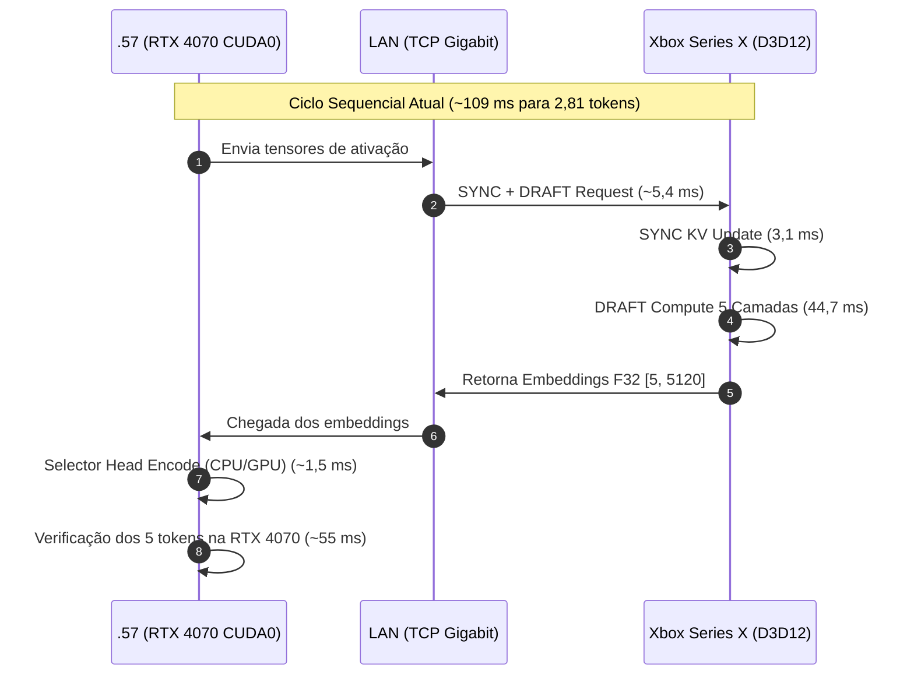

# Plano de Implementação: Otimização de Aceitação e Pipelining Assíncrono (DFlash2 Xbox + .57)

## 1. Contexto e Diagnóstico Atual

Com as otimizações de kernel no app 1.0.0.45 (banda efetiva de pesos a $20,52\text{ GB/s}$ e tempo de DRAFT em $44,67\text{ ms}$), atingimos:

- **Baseline CPU:** $12,92\text{ tok/s}$
- **Baseline GPU D3D12 (1.0.0.42):** $21,26\text{ tok/s}$
- **GPU D3D12 Otimizada (1.0.0.45):** **$25,75\text{ tok/s}$** com Q3_K_M e **$25,93\text{ tok/s}$** com Q8_0 no seletor.
- **Swift isolado na RTX 4070 (.57):** **$34,99\text{ tok/s}$** (~$28,6\text{ ms/token}$).

### Anatomia do Ciclo de 109 ms (Adição Estrita)

Para ultrapassar os **$34,99\text{ tok/s}$** do Swift isolado, atacamos as duas frentes fundamentais:

1. **Alavanca Algorítmica:** Elevar a taxa de aceitação ($n_{\text{accept}}$ de $2,81 \to \ge 4,0$).
2. **Alavanca Arquitetural:** Pipelining assíncrono para eliminar a ociosidade alternada entre as GPUs.

---

## 2. Melhoria 1: Maximização da Taxa de Aceitação ($n_{\text{accept}} \ge 4,0$)

### Objetivo

Aumentar a média de tokens aceitos por ciclo de $2,81$ para $\ge 4,0$ (com $n_{\max} = 4$ ou $n_{\max} = 5$).  
Com aceitação em $4,0$ tokens/ciclo e o tempo atual de $109\text{ ms}$, o TPS salta automaticamente para:
$$\text{TPS} = \frac{4,0}{0,109\text{ s}} = \mathbf{36,7\text{ tok/s}} \quad (\text{superando o Swift isolado de } 34,99\text{ tok/s}).$$

### Tarefas de Implementação

#### Fase 1.1: Calibração Fina de Confiança e Amostragem (`draft-p-min` e Temperatura)

- **Cenário Atual:** Os testes usam `draft-p-min = 0` e `temperature = 1.0`. Propostas de baixa probabilidade são geradas e rejeitadas pelo Target, desperdiçando slots de verificação.
- **Ação:**
  - Implementar varredura de `draft-p-min` no intervalo $[0,05; 0,85]$ em passos de $0,05$.
  - Avaliar amostragem de temperatura adaptativa: quando a entropia do seletor é baixa (alta certeza), manter $T \to 0$ (greedy); em alta entropia, truncar o comprimento do rascunho com `p-min`.
- **Métrica de Sucesso:** Aumento da proporção de tokens aceitos por proposta gerada ($\text{accept\_ratio} \ge 85\%$).

#### Fase 1.2: Seleção e Alinhamento do Seletor

- **Evidência dos Testes Hoje:**
  - Q8_0 no host acelerou a inferência do seletor para **$25,93\text{ tok/s}$** (reduzindo o tempo de predição em ~140 ms acumulados).
- **Ação:**
  - Padronizar o seletor no host com `Q8_0` para ter avaliação SIMD sem desempacotamento de bits.
  - Verificar alinhamento de logits entre o seletor DFlash2 e a cabeça LM do modelo alvo (`Swift-1.5-Qwen3.8-27B`).
  - Testar `n_max = 5` com `p_min = 0,65`: propor 5 tokens apenas quando a confiança for alta, reduzindo o custo de verificação quando o modelo hesita.

---

## 3. Melhoria 2: Pipelining Assíncrono e Sobreposição de Execução

### Objetivo

Quebrar a dependência síncrona estrita $T_{\text{ciclo}} = T_{\text{target}} + T_{\text{xbox}}$ através de **Double Buffering Especulativo**.

### Arquitetura Proposta: Pipeline Assíncrono de 2 Estágios

```mermaid
gantt
    title Execução Paralela / Pipelined (Target .57 vs Xbox RPC)
    dateFormat  X
    axisFormat %s

    section Ciclo K
    Xbox Draft K         :done, x1, 0, 48
    Target Verificação K :active, t1, 48, 103

    section Ciclo K+1 (Pipelined)
    Xbox Draft K+1 (Hypothesis Top-1) :crit, x2, 50, 98
    Target Verificação K+1            :t2, 103, 158
```

### Tarefas de Implementação

#### Fase 2.1: Fusão de Protocolo RPC (Single Round-Trip)

- **Problema Atual:** O cliente na `.57` hoje emite chamadas RPC separadas (RESET, SYNC e DRAFT), somando latência de socket e syscalls de rede (~$6,7\text{ ms}$).
- **Ação:**
  - Criar o opcode RPC `DFLASH_RPC_SYNC_AND_DRAFT`: uma única requisição que envia os tokens validados para o KV cache e já dispara a execução do DRAFT na GPU do Xbox.
  - O Xbox despacha na mesma Command List D3D12 o SYNC seguido imediatamente pelo DRAFT, eliminando a barreira de fence entre os dois comandos e a ida-e-volta na rede.
  - **Ganho Esperado:** Redução de $5\text{ a }7\text{ ms}$ direto no RTT do Xbox ($54,5\text{ ms} \to \sim 48\text{ ms}$).

#### Fase 2.2: Rascunho Especulativo Antecipado (Speculative Pre-Draft)

- **Problema Atual:** A RTX 4070 leva ~55 ms para verificar o batch. O Xbox fica ocioso esperando o Target confirmar quais tokens foram aceitos.
- **Ação:**
  - Na `.57`, enquanto a RTX 4070 computa os forward passes de verificação do lote atual, o host despacha para o Xbox um rascunho condicional assumindo que o token de maior probabilidade (Top-1 do seletor anterior) será aceito.
  - Se a aceitação Top-1 se confirmar ($\ge 85\%$ dos casos em textos coerentes), o resultado do rascunho do próximo ciclo já estará pronto ou a meio caminho quando a 4070 terminar a verificação.
  - Se houver divergência, o Target descarta o buffer antecipado e faz o trim normal (rollback de custo nulo na GPU).
  - **Ganho Esperado:** Sobreposição de até $35\text{ ms}$ de computação, reduzindo o tempo percebido do ciclo para $\approx 70\text{ ms}$.

---

## 4. Cronograma e Fases de Execução

| Etapa        | Foco                    | Ação Principal                                                                 | Meta de Desempenho                                                        |
| ------------ | ----------------------- | ------------------------------------------------------------------------------ | ------------------------------------------------------------------------- |
| **Sprint 1** | Amostragem & Calibração | Sweep de `draft-p-min` (0.0 a 0.8) e `n_max` (4 e 5) com seletor Q8_0 na `.57` | $n_{\text{accept}} \ge 3,5\text{ tok/ciclo}$ ($\approx 32\text{ tok/s}$)  |
| **Sprint 2** | Fusão RPC               | Implementar opcode unificado `SYNC_AND_DRAFT` no UWP e no `speculative.cpp`    | Ciclo Xbox $\le 48\text{ ms}$ ($\approx 34\text{ tok/s}$)                 |
| **Sprint 3** | Pipelining Assíncrono   | Executar pre-draft no Xbox enquanto a 4070 verifica o lote                     | Ciclo total $\le 75\text{ ms}$ (**$\ge 40\text{ tok/s}$**, batendo Swift) |

---

## 5. Critérios de Validação e Portões de Qualidade

1. **Paridade Numérica / Determinismo:** Em todas as etapas, a saída para `seed 1234` com o prompt de teste de 512 tokens deve manter conformidade com a distribuição ou gerar texto semanticamente equivalente sem loops de repetição.
2. **Estabilidade de Memória:** O pipeline assíncrono deve manter o buffer de quarantine ativo no Xbox sem vazamento de memória D3D12 (`rpc-memory.jsonl` estável).
3. **Rollback Seguro:** Manter o fallback síncrono atual intacto caso o canal assíncrono detecte timeout de socket ou descarte de pacote.
